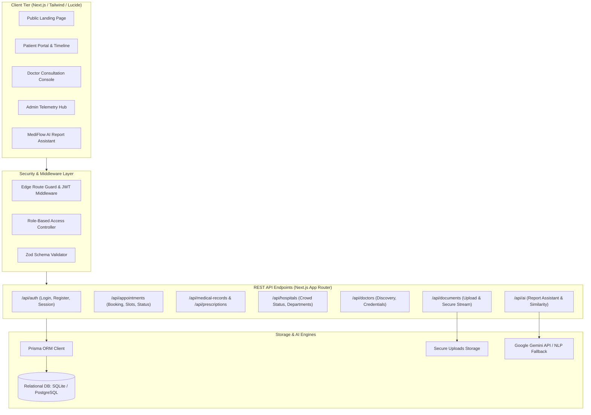
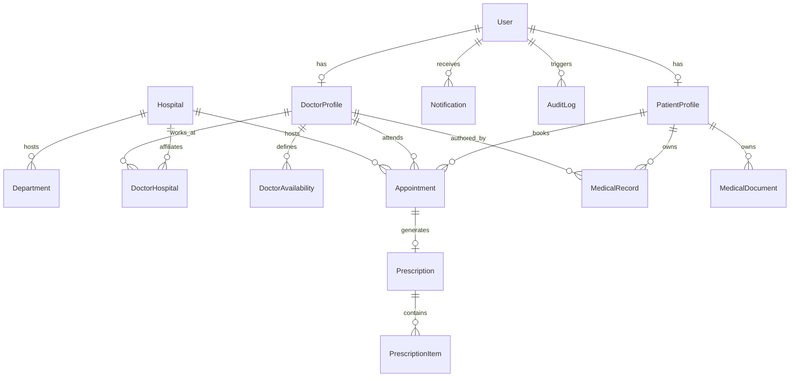

# MediFlow — Integrated Smart Healthcare Access & Record System
### For Urban and Semi-Urban Communities

[](https://nextjs.org/)
[](https://react.dev/)
[](https://www.typescriptlang.org/)
[](https://tailwindcss.com/)
[](https://www.prisma.io/)
[](#security)

MediFlow is a production-grade, full-stack healthcare web application architected to address fragmented medical care access and disparate health records in urban and semi-urban communities. It establishes a unified digital ecosystem connecting **Patients**, **Certified Doctors**, **Multi-Specialty Hospitals**, and **Healthcare Administrators**.

---

## Table of Contents
1. [Project Overview](#project-overview)
2. [Problem Statement](#problem-statement)
3. [Objectives](#objectives)
4. [Key Features](#key-features)
5. [Technology Stack](#technology-stack)
6. [System Architecture](#system-architecture)
7. [Database Architecture & ER Diagram](#database-architecture)
8. [User Roles & Access Matrix](#user-roles)
9. [REST API Documentation](#rest-api-documentation)
10. [Demo Accounts (Instant Evaluation)](#demo-accounts)
11. [Installation & Setup](#installation--setup)
12. [Running Locally](#running-locally)
13. [AI Features & Safety Protocol](#ai-features)
14. [Security & Compliance](#security)
15. [Automated & Integration Testing](#testing)
16. [Future Scalability](#future-scalability)
17. [Academic Disclaimer & Limitations](#limitations)

---

## Project Overview

In urban and semi-urban localities, patients frequently face severe OPD overcrowding, uncertain waiting times, lost paper prescriptions, and opaque medical lab jargon. Meanwhile, doctors struggle with missing longitudinal patient history, conflicting schedule management, and manual prescription writing.

MediFlow solves these challenges with a single, synchronized platform:
- **Public & Patient Tier**: Live hospital crowd footfall indicators, verified doctor search, collision-free slot booking, digital health timeline, and plain-English AI assistance for lab reports.
- **Doctor Tier**: Clinical encounter console, availability scheduler, electronic prescription authoring with dosage & frequency, and patient record access.
- **Admin Tier**: Hospital management, OPD crowd density calibration, practitioner credential verification, and immutable security audit logs.

---

## Problem Statement

1. **Overcrowded Outpatient Departments (OPD)**: Patients travel to healthcare facilities without prior awareness of queue congestion, resulting in hours of idle waiting.
2. **Fragmented Longitudinal Records**: Medical histories are scattered across physical paper files, hindering emergency and cross-specialty decision making.
3. **Complex Medical Jargon**: Patients receiving laboratory blood panels or radiology reports struggle to understand reference intervals and abbreviations.
4. **Scheduling Collisions**: Primitive booking systems allow double bookings and manual scheduling errors.

---

## Objectives

- Provide transparent, real-time hospital crowd estimation (Low, Moderate, High, Very High) with estimated wait times.
- Implement an automated appointment booking workflow with **mathematical double-booking prevention**.
- Build an end-to-end chronological health timeline linking consultations, lab reports, imaging, vaccinations, and prescriptions.
- Deliver an educational **MediFlow AI Report Assistant** providing plain-English explanations of clinical biomarkers with strict safety guardrails.
- Maintain a zero-trust role-based access control (RBAC) architecture with encrypted session cookies and audit logging.

---

## Key Features

### 1. Hospital Crowd & Waiting Time System
- Visual status indicators: `LOW` (< 20m wait), `MODERATE` (20-45m wait), `HIGH` (> 45m wait), and `VERY_HIGH` (Critical capacity).
- Real-time display of 24/7 trauma care, emergency contact numbers, and available clinical departments.
- Administrative control panel allowing instant telemetry adjustments during surges.

### 2. Double-Booking Protected Scheduling
- Dynamic slot computation based on the physician's weekly timetable and slot intervals (15, 20, 30, 45, or 60 minutes).
- Real-time collision detection: Confirmed and requested bookings lock the corresponding slot, returning HTTP 409 Conflict if another user attempts simultaneous reservation.
- Automated appointment lifecycle: `REQUESTED` → `CONFIRMED` → `COMPLETED` / `CANCELLED` / `REJECTED`.

### 3. Chronological Patient Health Timeline
- Unified chronological log tracking Consultations, Lab Reports, Prescriptions, Diagnoses, Imaging Scans, and Immunizations.
- Direct filtering by record category with doctor and hospital attribution metadata.

### 4. Digital E-Prescriptions with Printable Clinical Layout
- Structured prescription items containing Medicine Name, Dosage, Frequency (e.g. 1-0-1), Duration, and Specific Instructions.
- Formatted printable clinical letterhead view (`window.print()`) featuring hospital header, doctor license number, patient demographic summary, diagnosis, general lifestyle advice, and physician signature block.

### 5. Secure Medical Document Vault
- Validated multipart file upload for PDF, PNG, JPG, and WEBP formats with 10MB size guard.
- Cryptographically randomized file storage preventing guessable URL enumeration.
- Authenticated streaming download endpoint verifying patient ownership or clinical authorization.

### 6. MediFlow AI Report Assistant & Similarity Engine
- **Report Terminology Explainer**: Translates abbreviations (HbA1c, LDL, HDL, WBC, Platelets, Creatinine, Bilirubin, SGPT, TSH, CRP) into plain English with typical reference intervals and physician discussion questions.
- **Report Similarity Engine**: Calculates Jaccard biomarker parameter overlap (%) between historical and current reports, displaying quantitative delta shifts.
- **Safety Enforcement**: Embeds mandatory non-diagnostic disclaimers and explicitly prohibits disease diagnosis or drug prescription.

---

## Technology Stack

| Layer | Technologies |
|---|---|
| **Frontend Framework** | Next.js 15.1 (App Router), React 19, TypeScript |
| **Styling & UI** | Tailwind CSS 3.4, Lucide React Icons |
| **Data Visualization** | Recharts (Area Charts, Bar Charts, Trend Analysis) |
| **Backend & APIs** | Next.js Server Handlers, Node.js v26 runtime |
| **Database & ORM** | PostgreSQL compatible, Prisma ORM 6.4 with SQLite zero-dependency local default |
| **Authentication** | JWT sessions via `jose`, HTTP-only secure cookies, Bcrypt password hashing |
| **Validation** | Zod schema validation (client-side and server-side) |
| **AI Integration** | Modular service layer (Google Gemini 1.5 Flash + Clinical NLP Fallback Parser) |

---

## System Architecture



---

## Database Architecture

The schema contains 14 normalized relational models:



---

## User Roles

| Role | Access Permissions & Responsibilities |
|---|---|
| **PATIENT** | Profile management, doctor discovery, hospital crowd monitoring, appointment booking, rescheduling/cancelling, medical timeline inspection, document uploads/downloads, prescription review, AI report explanation. |
| **DOCTOR** | Consultation queue management, appointment approval/rejection, weekly schedule configuration, clinical encounter room, digital prescription generation, patient medical history review. |
| **ADMIN** | Doctor credential approvals/rejections, hospital facility creation, crowd level & waiting time telemetry calibration, appointment monitoring, security audit logs. |

---

## REST API Documentation

### Authentication
- `POST /api/auth/register` — Register a patient or submit doctor application.
- `POST /api/auth/login` — Authenticate credentials and receive HTTP-only JWT cookie.
- `POST /api/auth/logout` — Invalidate session cookie.
- `GET /api/auth/me` — Inspect active user profile and unread notification counter.

### Doctors & Hospitals
- `GET /api/doctors` — Search and filter verified doctors by specialization, hospital, or city.
- `GET /api/doctors/[id]` — Doctor profile, hospital affiliations, and schedule.
- `PATCH /api/doctors/[id]` — Update doctor profile, bio, or fees.
- `GET /api/hospitals` — List hospitals with crowd levels, wait times, and departments.
- `GET /api/hospitals/[id]` — Detailed hospital information.
- `PATCH /api/hospitals/[id]` — (Admin) Update hospital crowd status and wait times.

### Appointments
- `GET /api/appointments` — List appointments filtered by user role.
- `POST /api/appointments` — Book appointment with double-booking prevention.
- `GET /api/appointments/[id]` — Detailed appointment data with prescription and notes.
- `PATCH /api/appointments/[id]` — Update appointment status (`CONFIRMED`, `COMPLETED`, `CANCELLED`, `REJECTED`, or reschedule slot).
- `GET /api/appointments/slots` — Dynamic slot calculation for doctor and date.

### Records & Prescriptions
- `GET /api/medical-records` — Chronological timeline records for a patient.
- `POST /api/medical-records` — Create clinical note or diagnostic entry.
- `GET /api/prescriptions` — List issued prescriptions.
- `POST /api/prescriptions` — Author multi-item prescription and sync to health timeline.
- `GET /api/prescriptions/[id]` — Full printable prescription view.

### Documents & AI
- `POST /api/documents` — Secure multipart file upload with optional AI summarization.
- `GET /api/documents/download/[fileName]` — Authenticated stream download.
- `POST /api/ai/report-explanation` — Educational breakdown of medical lab text.
- `POST /api/ai/report-similarity` — Comparative biomarker delta analysis and similarity score.

---

## Demo Accounts

Pre-seeded accounts are provided for instant evaluation:

| Role | Email | Password | Persona Details |
|---|---|---|---|
| **Patient** | `patient@mediflow.com` | `Password123!` | Aarav Gupta (Noida) • Active timeline, upcoming appointment |
| **Doctor (Approved)** | `doctor.sharma@mediflow.com` | `Password123!` | Dr. Rajesh Sharma (Cardiology) • 14 yrs exp • MCI licensed |
| **Doctor (Pending)** | `doctor.kapoor@mediflow.com` | `Password123!` | Dr. Vikram Kapoor (Neurology) • Awaiting admin credential check |
| **Administrator** | `admin@mediflow.com` | `Admin123!` | Dr. Alok Verma • System Administrator & Medical Director |

> [!TIP]
> The login page includes a **One-Click Demo Login** widget to auto-populate credentials for any role.

---

## Installation & Setup

### Prerequisites
- Node.js v18+ (tested on v26.7.0)
- npm v9+ (tested on v11.19.0)

### 1. Clone or Open Project Directory
```bash
cd "D:\project 2"
```

### 2. Install Dependencies
```bash
npm install
```

### 3. Configure Environment Variables
Copy `.env.example` to `.env`:
```bash
cp .env.example .env
```
Default `.env` settings:
```ini
DATABASE_URL="file:./dev.db"
JWT_SECRET="mediflow_production_grade_jwt_secret_key_987654321_secure"
NEXT_PUBLIC_APP_URL="http://localhost:3000"
GEMINI_API_KEY="" # Optional: activates live Gemini 1.5 Flash API
UPLOAD_DIR="./uploads"
```

### 4. Database Setup & Seeding
```bash
# Push Prisma schema to SQLite
npx prisma db push

# Seed comprehensive demo dataset
npm run db:seed
```

---

## Running Locally

### Development Mode
```bash
npm run dev
```
Navigate to `http://localhost:3000`.

### Production Build & Run
```bash
npm run build
npm start
```

---

## AI Features & Safety Protocol

1. **Modular Service Layer (`src/lib/ai/`)**:
   - `gemini.ts`: Connects to Google Gemini 1.5 Flash when `GEMINI_API_KEY` is provided.
   - `fallbackAnalyzer.ts`: Deterministic clinical NLP engine parsing 60+ biomarkers, reference ranges, and plain-English meanings.
   - `similarity.ts`: Computes Jaccard parameter similarity across sequential test dates.
2. **Safety Compliance**:
   - Explicitly rejects medical diagnosis, prescription generation, and dosage alterations.
   - Every AI response embeds the mandatory educational disclaimer:
     > *"This AI-generated explanation is for educational purposes only and is not a medical diagnosis or a substitute for professional medical advice. Consult a qualified healthcare professional for medical decisions."*

---

## Security & Compliance

- **Role-Based Access Control (RBAC)**: Enforced through Next.js middleware and API route token validation.
- **Session Security**: HTTP-only, SameSite lax cookies preventing XSS token exfiltration.
- **Input Sanitization**: Strict Zod schemas validating all inbound API payloads.
- **File Upload Protection**: Content-Type verification (PDF, PNG, JPG), size ceilings (10MB), and cryptographically randomized storage filenames to prevent path traversal and unauthenticated enumeration.
- **Audit Logging**: Sensitive events (logins, doctor credential approvals, prescription issuances, crowd updates) are recorded in the `AuditLog` table.

---

## Automated & Integration Testing

Run the automated integration suite:
```bash
npx tsx scripts/test-workflows.mjs
```

### Test Suite Coverage:
- Database model integrity & foreign key constraints.
- Bcrypt password hashing & authentication rejection.
- Multi-criteria doctor and hospital discovery.
- Atomic appointment booking & **double-booking conflict rejection (409 Conflict)**.
- Digital prescription generation & automatic health timeline synchronization.
- AI report explanation & mandatory safety disclaimer validation.
- Report similarity calculation & biomarker delta tracking.
- Administrative doctor approval and live hospital crowd updates.

---

## Future Scalability

The application is structured for straightforward cloud deployment and extension:
- **Database**: Change `provider = "postgresql"` in `prisma/schema.prisma` and update `DATABASE_URL` for Neon, Supabase, or AWS RDS.
- **File Storage**: Swap `src/lib/storage.ts` with AWS S3 SDK or Cloudinary for cloud object storage.
- **Notifications**: Integrate Twilio for SMS reminders or Nodemailer / SendGrid for appointment confirmation emails.
- **Docker**: Containerize with the provided multi-stage Next.js Dockerfile pattern.

---

## Academic Disclaimer & Limitations

- **Academic Project**: MediFlow is an academic and portfolio project developed as a full-stack health informatics platform.
- **Simulation Notice**: Hospital crowd levels and waiting times are calculated approximations intended for demonstration.
- **Non-Diagnostic**: MediFlow AI is purely an educational glossary tool and does not provide clinical diagnoses. Always consult licensed medical doctors for medical treatment.

---

## Contributors
Developed as a B.Tech CSE Major Project and Portfolio Healthcare Platform.
